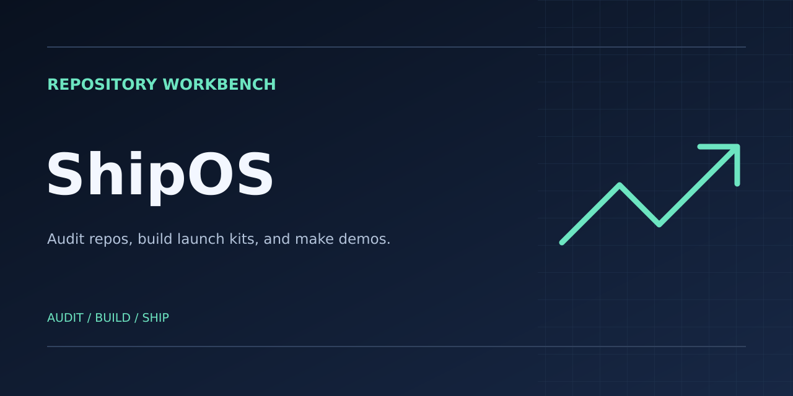
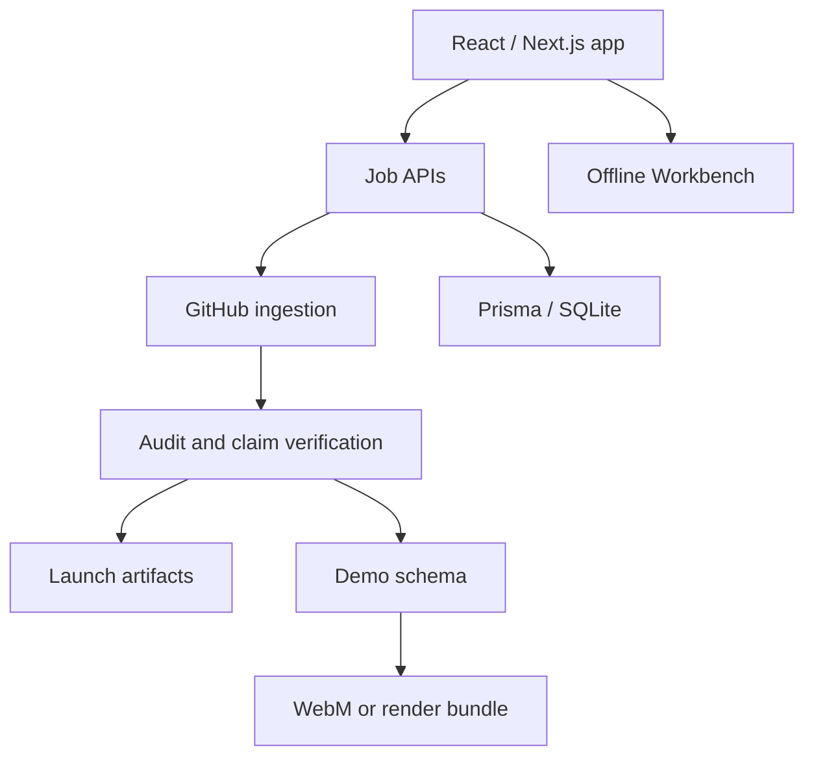

# ShipOS — The Universal Submission Engine



[Repository](https://github.com/CodesbyFebin/Ship-Repo-OS) · [Issues](https://github.com/CodesbyFebin/Ship-Repo-OS/issues) · [Pull requests](https://github.com/CodesbyFebin/Ship-Repo-OS/pulls) · [Looping GIF](docs/media/repo-preview.gif) · [MP4 teaser](docs/media/repo-teaser.mp4) · [Captions](docs/media/repo-teaser.vtt)

     [](https://github.com/CodesbyFebin/Ship-Repo-OS/actions/workflows/ci.yml)  

## Overview

ShipOS helps developers turn a GitHub repository into a launch or submission kit. It audits repository evidence, drafts a README and optimization assets, and prepares demo material. The full package records whether claims are verified, partial, or rejected. The [Proof Ledger](#proof-ledger) links this README's main capability claims to source files.

### The problem

Preparing a project for launch means turning repository details into clear documentation, proof, and media. That work is easy to repeat across tools, and unsupported claims can make their way into the final package.

### The solution

Start with a repository URL for the live engines or run GitHub Workbench on local evidence. ShipOS puts repository auditing, launch assets, developer utilities, and demo production in one workspace.

## Contents

- [Features and modes](#features-and-modes)
- [Quick start](#quick-start), [environment variables](#environment-variables), and [troubleshooting](#troubleshooting)
- [Architecture](#architecture), [project structure](#project-structure), and [tech stack](#tech-stack)
- [Available scripts](#available-scripts) and [API examples](#api-examples)
- [Testing and continuous integration](#testing-and-continuous-integration), [deployment](#deployment), and [security](#security)
- [Repository statistics](#repository-statistics), [commit intelligence](#commit-intelligence), and [development history](#recent-development-history)
- [Why this repository](#why-this-repository), [proof ledger](#proof-ledger), and [roadmap](#roadmap)
- [FAQ](#faq), [support](#support-and-community), and [contributing](#contributing)
- [Changelog](#changelog), [acknowledgments](#acknowledgments), [star history](#star-history), and [license](#license)

## Features and modes

| Mode | What it does | Implementation |
| --- | --- | --- |
| **GitHub Workbench** | 40 evidence checks, 30 launch assets, and 30 runnable utilities. Exports a profile README, banner previews, and launch files. The local CLI produces GIF, MP4, and WebVTT media. | [Workbench guide](docs/workbench.md) |
| **Full Package** | Creates a README, demo script and storyboard, pitch deck, project report, viva prep, compliance checklist, claim ledger, and export bundle. Includes SEO and repo health scores. | [Pipeline](src/lib/shipos/pipeline.ts) |
| **Full Repo Auditor** | Runs 50 deterministic checks, assigns an S–F grade, and returns ranked fixes with code. Categories are docs (25 points), code quality (25), security (20), DevOps (15), and community (15). Supports strictness levels and a zero-network file-list scan. | [Audit rules](src/lib/shipos/repo-audit.ts) |
| **Optimization Engine** | Measures SEO, AEO, and GEO signals on a 0–100 scale. Its 54-point review pack includes description, topics, `agents.txt`, `llms.txt`, FAQ, JSON-LD, AI crawler guidance, and launch copy. Apply changes and rerun to measure results. | [Optimizer](src/lib/shipos/optimizer.ts) |
| **Demo Maker** | Creates a 10-act film plan for 60, 150, or 300 seconds, with a brief, captions, and a scene editor. Uses an LLM-written voiceover script when available, with a deterministic fallback. Exports WebM or hands off to Render Cloud. | [Demo engine](src/lib/shipos/demo-engine.ts) |
| **README Upgrader** | Audits a README across eight categories, produces an upgraded draft, and reports its score under the README rubric. | [Upgrader](src/lib/shipos/upgrader.ts) |
| **Video Studio (Path A)** | Plays an editable cinematic scene schema on a canvas and records WebM in supported browsers. | [Video Studio](src/components/shipos/studio/video-studio.tsx) |
| **Render Cloud (Path B)** | Models a 4K workflow and its 300 GPU-second daily budget. Exports a Hugging Face Space bundle for GPU-assisted voiceover, banners, and captions, with Remotion and FFmpeg render steps. The app tracks progress through a time-based job simulation. | [Render worker](src/lib/shipos/render-worker.ts) · [Deployment bundle](src/lib/shipos/hf-bundle.ts) |
| **Competitor Radar** | Bundled November 8 snapshot of 15 repo-to-video tools, five categories, an 11-capability matrix, four patterns, and six roadmap opportunities. | [Competitor data](src/lib/shipos/competitors.ts) |
| **Model Radar** | Browsable bundled catalog of open and free model options, with capability filters. | [Model data](src/lib/shipos/hf-models.ts) |
| **PRO** | Demo tier for the 4K render flow, audit schedule records, team seats, and API-key management for `/api/v1/audit`. | [PRO API](src/app/api/pro/route.ts) · [Public audit API](src/app/api/v1/audit/route.ts) |

### Publishing media

The banner above is the committed 1280 × 640 PNG. The repository also includes an [SVG banner](docs/media/banner.svg), the GIF, the MP4 teaser, and WebVTT captions. The [Workbench guide](docs/workbench.md#publish-the-media) explains how to create your own media and publish it with a profile README or GitHub social preview. An [alternate capsule banner](https://capsule-render.vercel.app/api?type=waving&height=220&text=Ship-Repo-OS&fontSize=60&fontAlignY=36&desc=GitHub%20repository%20submission%20engine%20with%20provenance%20verification&descAlignY=58&descSize=16&color=0:0ea36d,100:5eead4&section=header&reversal=false) is available for the same project.

## Quick start

Use Git, Node.js 24, and Bun 1.3.4, matching [CI](.github/workflows/ci.yml). The CLI media commands also require FFmpeg with librsvg and libx264.

```bash
git clone https://github.com/CodesbyFebin/Ship-Repo-OS.git
cd Ship-Repo-OS

bun install --frozen-lockfile
cp .env.example .env
mkdir -p prisma/db && touch prisma/db/custom.db
bun run db:push
bun run dev
```

Open <http://localhost:3000> and select **GitHub Workbench**. To use it from the terminal, run `node scripts/workbench.mjs --help` or `bun run workbench --help`.

### Usage examples

```bash
# Audit a local checkout, then generate a launch pack for review.
node scripts/workbench.mjs audit .
node scripts/workbench.mjs pack --repo CodesbyFebin/Ship-Repo-OS --against . --out ./local-launch-pack

# Try one of the 30 utilities.
node scripts/workbench.mjs tool semver-bump --input "1.1.0 minor"
# 1.2.0
```

See the [Workbench guide](docs/workbench.md) for evidence inputs, score calculation, exports, and media commands.

## Environment variables

| Variable | Use | Required |
| --- | --- | --- |
| `DATABASE_URL` | Prisma SQLite database. The sample value is `file:./db/custom.db`. Use an absolute SQLite path for standalone deployment. | For the server |
| `GITHUB_TOKEN` | Optional token used by the [GitHub scraper](src/lib/shipos/scrape.ts) for authenticated API requests. Keep it server-side. | No |
| `OPENAI_API_KEY` | Listed as an optional example in `.env.example`. The current [LLM bridge](src/lib/shipos/llm.ts) initializes the ZAI SDK. | No |

### Troubleshooting

| Symptom | Likely cause | Fix |
| --- | --- | --- |
| `command not found: bun` | Bun is unavailable | Install the CI-pinned version and rerun setup. |
| Install returns `EACCES` | A global install needs elevated privileges | Run the project scripts with a user-local Bun installation. |
| Startup reports a missing variable or SQLite file | Local configuration or database setup is incomplete | Copy `.env.example`, create the default SQLite path, and run `bun run db:push`. |
| CI fails while the local run passes | Runtime or dependency drift | Match the [CI versions and commands](.github/workflows/ci.yml) and use a frozen install. |
| Port 3000 is in use | Another process is listening | Stop that process or run `bunx next dev -p 3001`. |

## Architecture



Live ingestion retries transient failures with exponential backoff. When ingestion fails and a previous snapshot is available, ShipOS labels that evidence as a snapshot. A GitHub 404 is returned as a repository error. The full package uses the resulting evidence to build its claim ledger and exports.

The audits run deterministically. LLM-assisted demo scripts and the optimization pack can fall back to templates when the LLM is unavailable.

### Design notes

- **TypeScript-first.** Use the shared contracts and let the type checker catch interface drift.
- **Locked dependencies.** Use the committed Bun lockfile for repeatable installs.
- **Typed storage.** Use the [Prisma schema](prisma/schema.prisma) for data-model changes and document how to apply them.
- **Tests and CI.** Use the regression tests and workflow when changing behavior or diagnosing a build.

## Project structure

| Path | Role |
| --- | --- |
| [`src/app/`](src/app/) | App Router pages and API routes for shipping, projects, audit, optimization, demos, render jobs, upgrades, PRO, schedules, teams, API keys, and feedback. |
| [`src/lib/shipos/`](src/lib/shipos/) | Repository ingestion, scoring, fixes, generators, provenance, optimizer, demo engines, render worker, and radar catalogs. |
| [`src/lib/shipos/workbench/`](src/lib/shipos/workbench/) | Evidence checks, launch pack, and utilities shared by the app and CLI. |
| [`src/components/shipos/`](src/components/shipos/) · [`src/ui/`](src/ui/) | Mode interfaces and the dark-first Material 3-inspired component kit. |
| [`prisma/`](prisma/) · [`scripts/`](scripts/) · [`tests/`](tests/) | SQLite schema, CLI, and regression tests. |
| [`docs/`](docs/) · [`public/`](public/) · [`examples/websocket/`](examples/websocket/) · [`mini-services/`](mini-services/) | Guides, media, static assets, a WebSocket example, and a reserved service directory. |
| [`Caddyfile`](Caddyfile) · [`package.json`](package.json) · [`bun.lock`](bun.lock) | Reverse-proxy example, package manifest, and dependency lockfile. |

## Tech stack

| Area | Technology |
| --- | --- |
| Application | Next.js 16.4.6 App Router, React 19, TypeScript 5, and JavaScript |
| UI and client state | Tailwind CSS 4, Radix UI, TanStack Query, Framer Motion, and the local component kit |
| Data and validation | Prisma 6, SQLite, and Zod 4 |
| Development and CI | Node.js 24, Bun 1.3.4, ESLint, Node test runner, and GitHub Actions |
| Media and exports | Canvas, MediaRecorder, JSZip, FFmpeg, and the Remotion-based render bundle |

## Available scripts

Run each script as `bun run <script>`. See [package.json](package.json) for its exact definition.

| Script | Command or purpose |
| --- | --- |
| `dev` | `next dev -p 3000` |
| `build` | Runs `next build` and copies static assets into the standalone bundle. |
| `start` | `node .next/standalone/server.js` |
| `test` | `node --test tests/*.test.mjs` |
| `typecheck` | `tsc --noEmit` |
| `lint` | `eslint .` |
| `lint:workbench` | ESLint for the Workbench UI, shared modules, and CLI scripts. |
| `db:push` | `prisma db push` |
| `db:generate` | `prisma generate` |
| `db:migrate` | `prisma migrate dev` |
| `db:reset` | `prisma migrate reset`. This resets the configured database. |
| `workbench` | `node scripts/workbench.mjs` |

## API examples

```bash
# Full package
curl -X POST http://localhost:3000/api/ship \
  -H 'content-type: application/json' \
  -d '{"repoUrl":"https://github.com/honojs/hono","preset":"meta-hackathon"}'

# Full repo audit
curl -X POST http://localhost:3000/api/audit \
  -H 'content-type: application/json' \
  -d '{"repoUrl":"https://github.com/honojs/hono","strictness":"balanced"}'

# Five-minute demo film
curl -X POST http://localhost:3000/api/demo \
  -H 'content-type: application/json' \
  -d '{"repoUrl":"https://github.com/honojs/hono","targetSeconds":300,"style":"launch"}'

# Optimization pack
curl -X POST http://localhost:3000/api/optimize \
  -H 'content-type: application/json' \
  -d '{"repoUrl":"https://github.com/honojs/hono"}'
```

Job creation returns `{ ok, id }`. Poll `GET /api/projects/:id` for a full package. For the other examples, poll `GET /api/audit/:id`, `GET /api/demo/:id`, or `GET /api/optimize/:id` and read `status` and `stage`. Download a finished full package at `GET /api/projects/:id/export`.

## Testing and continuous integration

```bash
bun run test
bun run lint:workbench
bun run typecheck
```

The [Repository checks workflow](.github/workflows/ci.yml) runs on pushes and pull requests and supports manual runs. It installs locked dependencies, generates the Prisma client, tests and lints Workbench, checks types, and builds the standalone app. See [current runs](https://github.com/CodesbyFebin/Ship-Repo-OS/actions/workflows/ci.yml) and the [release review](docs/release-review.md) for the original verification and lint scope.

## Deployment

Run `bun run build && bun run start` for the standalone Node.js build. Set the same absolute `DATABASE_URL` during schema setup and at runtime, and use a writable persistent volume for SQLite. The included [Caddyfile](Caddyfile) is a reverse-proxy example. For the 4K render workflow, use the separate export from Render Cloud.

## Security

Run the server as a trusted single-instance demo. The shared job, project, and demo license APIs require an authentication and authorization layer for public multi-tenant use. Keep live credentials out of source control and report vulnerabilities privately using the [security policy](SECURITY.md).

## Repository statistics

| Metric | Where to check |
| --- | --- |
| Stars and forks | Live badges above or the [GitHub repository](https://github.com/CodesbyFebin/Ship-Repo-OS). The supplied November 10 snapshot recorded zero of each. |
| Commit count and contributors | [Main history](https://github.com/CodesbyFebin/Ship-Repo-OS/commits/main/) and the dated snapshot below. |
| Languages | The supplied November 10 snapshot reported 71% TypeScript and 29% JavaScript. See the [repository language breakdown](https://github.com/CodesbyFebin/Ship-Repo-OS) for current figures. |
| Automation and tests | One [CI workflow](.github/workflows/ci.yml) and the [Workbench regression suite](tests/workbench.test.mjs). |
| License | [MIT](LICENSE). |

## Commit intelligence

The November 10, 2026 snapshot at [`724a8c7`](https://github.com/CodesbyFebin/Ship-Repo-OS/commit/724a8c752d1555a4cdca7be2f0f75cc9b061a6d9) contains 18 commits: eight dependency PR merges, eight Dependabot update commits, and two initial ShipOS commits. None of those 18 commit subjects uses a Conventional Commit prefix. The original snapshot did not resolve authors. The list below uses the repository's public commit author records.

### Recent development history

<details>
<summary>Show the 18 commits in the November 10 snapshot</summary>

| Commit | Type | Message | Author | Date |
| --- | --- | --- | --- | --- |
| [`724a8c7`](https://github.com/CodesbyFebin/Ship-Repo-OS/commit/724a8c752d1555a4cdca7be2f0f75cc9b061a6d9) | Merge | Merge pull request #8 from CodesbyFebin/dependabot/bun/radix-ui/react-dropdown-menu-2.2.1 | Febin Francis | 2026-11-10 |
| [`4d4b01b`](https://github.com/CodesbyFebin/Ship-Repo-OS/commit/4d4b01bd228081547a22c79151f8d9bdcf7c0ab9) | Merge | Merge pull request #6 from CodesbyFebin/dependabot/bun/radix-ui/react-toggle-1.2.1 | Febin Francis | 2026-11-10 |
| [`54afe5c`](https://github.com/CodesbyFebin/Ship-Repo-OS/commit/54afe5c968bbf7666747ebddc089389fe21462b3) | Dependency update | Bump @radix-ui/react-toggle from 1.1.10 to 1.2.1 | dependabot[bot] | 2026-11-10 |
| [`40985a4`](https://github.com/CodesbyFebin/Ship-Repo-OS/commit/40985a4cb457b4e0f89077832f62b7da09018146) | Dependency update | Bump @radix-ui/react-dropdown-menu from 2.1.16 to 2.2.1 | dependabot[bot] | 2026-11-10 |
| [`54d1a8a`](https://github.com/CodesbyFebin/Ship-Repo-OS/commit/54d1a8ad8ab9bdbe56e95669afb3286d5a717958) | Merge | Merge pull request #7 from CodesbyFebin/dependabot/bun/zustand-5.1.0 | Febin Francis | 2026-11-10 |
| [`9367127`](https://github.com/CodesbyFebin/Ship-Repo-OS/commit/936712760d9e03cabbe175f4383cde2be9362499) | Merge | Merge pull request #5 from CodesbyFebin/dependabot/bun/radix-ui/react-progress-1.2.1 | Febin Francis | 2026-11-10 |
| [`4e68a0c`](https://github.com/CodesbyFebin/Ship-Repo-OS/commit/4e68a0c3fa07801c2eed25cff9ca75093709b875) | Merge | Merge pull request #4 from CodesbyFebin/dependabot/bun/next-auth-4.24.15 | Febin Francis | 2026-11-10 |
| [`96f73d5`](https://github.com/CodesbyFebin/Ship-Repo-OS/commit/96f73d5668325367a42868b362be59ae7110c668) | Merge | Merge pull request #3 from CodesbyFebin/dependabot/bun/input-otp-1.5.0 | Febin Francis | 2026-11-10 |
| [`305714c`](https://github.com/CodesbyFebin/Ship-Repo-OS/commit/305714cdd9883e92fd8aa74de3b9845d826dac7d) | Merge | Merge pull request #2 from CodesbyFebin/dependabot/github_actions/actions/setup-node-7.1.0 | Febin Francis | 2026-11-10 |
| [`95481e2`](https://github.com/CodesbyFebin/Ship-Repo-OS/commit/95481e22fa100bf63bdfb43e0ab3b42cdc75d976) | Merge | Merge pull request #1 from CodesbyFebin/dependabot/github_actions/actions/checkout-7.0.1 | Febin Francis | 2026-11-10 |
| [`ad18c3a`](https://github.com/CodesbyFebin/Ship-Repo-OS/commit/ad18c3a4c9c78f9c439b34dd4e35eec959de249f) | Dependency update | Bump zustand from 5.0.10 to 5.1.0 | dependabot[bot] | 2026-11-10 |
| [`8c71bf2`](https://github.com/CodesbyFebin/Ship-Repo-OS/commit/8c71bf23e546cc100e258f30108cec4275f3d788) | Dependency update | Bump @radix-ui/react-progress from 1.1.8 to 1.2.1 | dependabot[bot] | 2026-11-10 |
| [`8dbdc84`](https://github.com/CodesbyFebin/Ship-Repo-OS/commit/8dbdc844dcd27f5ad6790102fd24e163d24f5ff2) | Dependency update | Bump next-auth from 4.24.13 to 4.24.15 | dependabot[bot] | 2026-11-10 |
| [`b0d6225`](https://github.com/CodesbyFebin/Ship-Repo-OS/commit/b0d6225b8c6a95f1c2a1bca919aca97136dc205c) | Dependency update | Bump input-otp from 1.4.2 to 1.5.0 | dependabot[bot] | 2026-11-10 |
| [`45894fd`](https://github.com/CodesbyFebin/Ship-Repo-OS/commit/45894fdd31d3055d53a8cc82cf274540c0364ed8) | Dependency update | Bump actions/setup-node from 4.4.0 to 7.1.0 | dependabot[bot] | 2026-11-10 |
| [`c5b11cf`](https://github.com/CodesbyFebin/Ship-Repo-OS/commit/c5b11cfb6d377b926213deb6f47129ffed3f1b3e) | Dependency update | Bump actions/checkout from 4.2.2 to 7.0.1 | dependabot[bot] | 2026-11-10 |
| [`f5f3040`](https://github.com/CodesbyFebin/Ship-Repo-OS/commit/f5f304052b1aee16be29d0f5c2d031c9dcef8a49) | Project setup | Ship ShipOS 1.1.0 and GitHub Workbench | Febin Francis | 2026-11-10 |
| [`7830904`](https://github.com/CodesbyFebin/Ship-Repo-OS/commit/7830904b693ffb53607628cf1c249fc1c16ee841) | Project setup | Initialize ShipOS repository | Febin Francis | 2026-11-10 |

</details>

## Why this repository

| Need | What ShipOS provides |
| --- | --- |
| Repeatable setup | A frozen install, documented SQLite setup, and a local CLI. |
| Traceable results | Source-linked evidence, deterministic checks, and a claim ledger in the full package. |
| Reviewable launches | One workbench for docs, settings recommendations, scripts, and media drafts. |
| Open development | Public history, CI results, issues, and pull requests. |

## Proof ledger

This table is also the citable facts index for the project. Sources point to the implementation or repository records.

| Claim | Evidence |
| --- | --- |
| The project uses TypeScript, React, Next.js, and Prisma. | [Manifest](package.json) · [TypeScript configuration](tsconfig.json) · [Prisma schema](prisma/schema.prisma) |
| Workbench provides 40 checks, 30 launch assets, and 30 utilities. | [Checks](src/lib/shipos/workbench/checks.mjs) · [Assets](src/lib/shipos/workbench/pack.mjs) · [Utilities](src/lib/shipos/workbench/tools.mjs) · [Catalog tests](tests/workbench.test.mjs) |
| The repository auditor scores 0–100 and provides ranked fixes. | [Audit rules](src/lib/shipos/repo-audit.ts) · [Fix library](src/lib/shipos/fixes.ts) |
| The full package includes an evidence ledger. | [Provenance verifier](src/lib/shipos/provenance.ts) · [Package pipeline](src/lib/shipos/pipeline.ts) |
| Demo Maker prepares voiceover scripts and film scenes. | [Demo engine](src/lib/shipos/demo-engine.ts) · [Demo runner](src/lib/shipos/demo-runner.ts) |
| The optimization pack provides SEO, AEO, and GEO guidance. | [Optimizer](src/lib/shipos/optimizer.ts) · [Catalog](src/lib/shipos/optimize-catalog.ts) |
| The repository has a CI workflow, automated tests, and an MIT license. | [Workflow](.github/workflows/ci.yml) · [Tests](tests/) · [License](LICENSE) |
| The repository is public and has a traceable development history. | [Repository](https://github.com/CodesbyFebin/Ship-Repo-OS) · [Snapshot commit](https://github.com/CodesbyFebin/Ship-Repo-OS/commit/724a8c752d1555a4cdca7be2f0f75cc9b061a6d9) |

<details>
<summary>Audit trail and claim limits</summary>

The attached snapshot described its own generated claims as verified. This merged README links directly to the relevant source. It treats star and fork counts as a dated snapshot, uses live badges for current values, and describes 4K rendering as an exportable workflow with an in-app simulation. It also keeps repository readiness scores separate from optimizer drafts and omits the unsupported claim that the codebase reads every environment variable listed in the example.

</details>

## Roadmap

See the [Competitor Radar](src/lib/shipos/competitors.ts) for product opportunities and the [release review](docs/release-review.md) for the remaining verification and deployment work identified in ShipOS 1.1. Track proposed milestones in [GitHub Issues](https://github.com/CodesbyFebin/Ship-Repo-OS/issues).

## FAQ

<details>
<summary>What can I run without the server?</summary>

Run the Workbench CLI on a local Git checkout for audits, launch packs, and utilities. The media command needs FFmpeg. Open the web app to use Video Studio or the server-backed modes.

</details>

<details>
<summary>Is ShipOS free?</summary>

The source is available under the MIT License. Browser WebM export and the offline tools run locally. Third-party rendering, model services, or hosting are subject to their own terms and quotas. The PRO checkout in this repository is a demo.

</details>

<details>
<summary>How do I verify the figures in this README?</summary>

Use the Proof Ledger for code and capability claims, the badges and GitHub Actions for live signals, and the dated commit table for the historical snapshot.

</details>

## Support and community

See [SUPPORT.md](SUPPORT.md) for help. [Open an issue](https://github.com/CodesbyFebin/Ship-Repo-OS/issues/new) with reproduction steps and versions for a bug, or explain the problem and desired outcome for a feature request. Use the private reporting route described in [SECURITY.md](SECURITY.md) for vulnerabilities.

## Contributing

Fork the repository, create a branch such as `feat/your-feature`, and run the relevant checks. Use descriptive commit subjects such as `feat:`, `fix:`, or `docs:`, and include verification results when you [open a pull request](https://github.com/CodesbyFebin/Ship-Repo-OS/compare). See [CONTRIBUTING.md](CONTRIBUTING.md) and the [code of conduct](CODE_OF_CONDUCT.md).

## Changelog

See [CHANGELOG.md](CHANGELOG.md) for release notes and the [GitHub commit history](https://github.com/CodesbyFebin/Ship-Repo-OS/commits/main/) for changes after the latest changelog entry.

## Acknowledgments

Thanks to the [project contributors](https://github.com/CodesbyFebin/Ship-Repo-OS/graphs/contributors) and Dependabot for the dependency updates recorded in the project history.

## Star history

[](https://github.com/CodesbyFebin/Ship-Repo-OS/stargazers)

[Star the repository](https://github.com/CodesbyFebin/Ship-Repo-OS/stargazers) · [Fork](https://github.com/CodesbyFebin/Ship-Repo-OS/fork)

## License

MIT. See [LICENSE](LICENSE).
